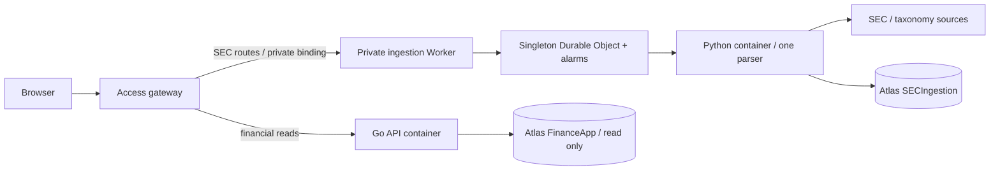

# SEC ingestion

The dashboard can import US 10-K, 10-Q, and associated amendments explicitly from its SEC view. Python 3.14 runs Arelle in one offline subprocess at a time; FastAPI handles control/read requests and PyMongo stores checkpoints and complete extraction generations. The experimental parser in `legacy/sec_parser` stays reference-only.



The ingestion Worker has no routes, preview URL, or `workers.dev` endpoint. Only the authenticated gateway calls its service binding. Browser mutations require same-origin JSON, a bounded body, and explicit allowed routes. The financial API remains read-only. SEC facts do not feed legacy statements, prices, metrics, or DCF.

## MongoDB setup

1. In Atlas **Database → Browse Collections → Create Database**, create `SECIngestion` with collection `schema`.
2. In **Database Access → Add New Database User → Password**, create `sec-ingestion-app` with a generated password. Choose a specific privilege: **readWrite on SECIngestion only**. Do not select read/write on all databases. This is a database user, not an Atlas API key.
3. Copy the driver's MongoDB connection URI, replace its username/password with this user's percent-encoded credentials, and keep the existing Atlas network rules. Keep the Go dashboard's original read-only credential separate.
4. Add these pairs to ignored `.env.production` and the GitHub **production Environment Secrets**, with the exact same names. Do not put dotenv quotes around the GitHub values.

```dotenv
SEC_MONGODB_URI='mongodb+srv://<writer>:<encoded-password>@<cluster>/SECIngestion?retryWrites=true&w=majority'
SEC_MONGODB_DATABASE=SECIngestion
SEC_USER_AGENT='Ledger <your-real-monitored-contact-email>'
```

Use a real email in place of the angle-bracket placeholder; an SEC API key is not needed. The application enforces database name `SECIngestion` and verifies effective permissions: built-in `readWrite` or an equivalent custom role must be confined to that database, without cluster or user/role administration privileges; database roles enforce the boundary even if application code fails. Only ingestion receives its writer URI/contact. No secret is compiled into frontend assets or images.

Bootstrap explicitly, once before the first deployment (and again when an intentional schema change requires it):

```sh
python3.14 -m venv ingestion/.venv
ingestion/.venv/bin/pip install --require-hashes -r ingestion/requirements-dev.lock
ingestion/.venv/bin/pip install --no-deps -e ingestion
ingestion/.venv/bin/python -m sec_ingestion bootstrap --env-file .env.production
node scripts/deploy.mjs --check
```

Bootstrap prints no URI and touches only `SECIngestion`. It creates `schema`, `issuers`, `requests`, `jobs`, `job_filings`, `filings`, `facts`, `contexts`, `units`, `labels`, `relationships`, `company_facts`, `registry`, and `control`, plus indexes. You do not need to create the remaining collections manually. Normal startup does not create indexes, scrape, or update the registry.

## Local development

Vite proxies `/api/v1/sec/*` to port 8081 and other API paths to Go on 8080. Put local SEC configuration in `.env.local` (or `.env`), and start the Python service with its settings loaded explicitly:

```sh
# Bootstrap the local URI first, as above using --env-file .env.local.
ingestion/.venv/bin/python -m uvicorn sec_ingestion.app:app --host 127.0.0.1 --port 8081 --env-file .env.local --no-access-log
```

Optional Vite `SEC_PROXY_TARGET` changes its SEC target. Container development:

```sh
docker compose --profile fixtures up -d --build
docker compose exec -T ingestion python -m sec_ingestion bootstrap
# http://127.0.0.1:3000/companies/DEMO
```

Fixture mode defaults to `SEC_OFFLINE=true`, so no SEC traffic can occur. To import intentionally with Atlas configuration, use `docker compose --env-file .env.local up --build` with `SEC_OFFLINE=false` explicitly set and a real `SEC_USER_AGENT`. Local services bind loopback and do not implement Access. Do not expose their ports publicly.

For Podman with the existing Atlas configuration, run from the repository root:

```sh
# Start mini-machine first if it is stopped.
SEC_OFFLINE=false podman-compose --parallel 1 \
  -f compose.yaml --env-file .env.production up -d --build
# http://127.0.0.1:3000/companies/AAPL?view=sec
```

This starts local services using the configured Atlas databases; explicit imports write to `SECIngestion`. The single-job build limit reduces peak disk usage on small Podman VMs. If a build reports `no space left on device`, check VM space with `podman machine ssh mini-machine df -h /sysroot`, remove unused untagged images with `podman image prune -f`, and retry with `--parallel 1`. Database volumes are not removed by image pruning.

## Requests and recovery

A fresh scrape is uniquely owned by normalized CIK for its entire history. Aliases deduplicate. Repeated fresh requests return its original job, even after completion or failure. Failed/cancelled jobs need an explicit retry. To change the selection of an unsuccessful first import, choose its new options and **Start updated import**; this is an explicit refresh, while **Retry saved import** resumes the original selection. Refresh is a separate action; choose latest annual/quarterly filings, a range, or the optional company-facts snapshot. Concurrent refreshes attach to an already active issuer job. A sparse unique active-CIK index independently enforces one active issuer job even if an admission lease expires. One global lease serializes processing; other accepted jobs queue in MongoDB.

Jobs are persisted before scheduling. Their URL contains `?view=sec&job=<id>`, so reloading or navigating away does not cancel them. A globally blocked queue exposes **Retry SEC access after diagnosis** on accepted jobs; this clears the block only after its persisted cooldown. Durable alarms wake the queue independently of browser polling. A container restart resumes its persisted filing plan/checkpoints after the global lease expires. If a registry lookup is blocked before a job exists, **Retry SEC access after diagnosis** explicitly clears the block after its cooldown; ordinary clicks never clear it. Retry skips completed checkpoints; **refresh** revalidates sources/checksums and creates new generations for changed content. Cancellation stops remaining work and terminates an active parser subprocess; a source request may take up to its bounded HTTP timeout to finish.

Production connections use primary reads and majority read/write concern. Download provenance is checkpointed before parsing, including for failed attempts. Facts, contexts, units, labels, and relationships are immutable within a filing's extraction generation. Readers use the filing's published generation pointer, switched only after every category is saved. Duplicate conflicting numeric occurrences remain distinct and exact decimal values are strings. Unpublished interrupted generations remain invisible. Old generations/checkpoints are retained for recovery/audit; no automatic retention/deletion job is included. Review storage before large backfills.

The deploy script hashes ingestion source, vendored transforms, and the dependency lock into `SEC_PARSER_VERSION`. A job cannot resume under another version; explicitly refresh with the current parser. Code rollback keeps existing records and provenance. Source files are temporary. See [SEC access policy](sec-access-policy.md) for privacy, limits, licensing, and block recovery.

## Deployment and rollout

Only the existing manual `workflow_dispatch` release deploys. CI tests with synthetic local filings; it never starts imports or requests SEC. The release deploys ingestion first, then the dashboard. The deployment script acquires an authenticated maintenance lock sharing the job-admission lease. Any accepted queued/running/cooling-down work rejects replacement; finish or cancel it first. While locked, new requests/retries are rejected. The lock releases in `finally`. If a deployment runner is forcibly killed, release it after inspecting the deployment using the command below.

```sh
node scripts/sec-maintenance.mjs off
```

The Python container runs on demand as `standard-1`; dashboard containers remain `lite`. Durable alarms keep outstanding work recoverable and respect persisted cooldowns. Idle services stop after ten minutes. A private service binding is the only ingestion entry point; Atlas still needs authorized egress. Never broaden network rules automatically.

Before accepting the first import:

1. Bootstrap and validate all twelve production keys without printing values. Deploy manually after checks pass.
2. Through Access, verify legacy dashboard reads and SEC company-list reads. Confirm unauthenticated SEC mutations fail and ingestion has no public URL.
3. Choose a known US issuer, choose a short advanced range containing **one filing**, and click scrape. This verifies Cloudflare-to-SEC egress and scoped Atlas writes. A `403` is a rollout blocker: follow the policy runbook rather than trying to bypass it.
4. Reload the job link; verify completed facts, dimensions, labels, and original source links. Repeat a fresh request and confirm the same job ID. Then explicitly refresh and check unchanged generations do not add duplicate facts.
5. Import a small date range; check cancellation, partial success, cold-start/restart recovery, and existing financial views. Live Cloudflare checks are required before calling rollout validated.

Rollback the dashboard independently with `node scripts/deploy.mjs --rollback <dashboard-version-id>`. Roll back ingestion with `node scripts/deploy.mjs --rollback-sec <ingestion-version-id>`; this takes the same idle-only maintenance lock and preserves MongoDB data. Use the final version of a release after its secrets were installed. An incompatible version must start a fresh refresh rather than resume old jobs. Preserve old Cloudflare images for rollback.

## Validation

```sh
ingestion/.venv/bin/python -m pytest -q ingestion/tests
# Disposable authenticated MongoDB only; this test creates users and drops SECIngestion:
SEC_TEST_MONGODB_URI='mongodb://<local-admin>:<password>@127.0.0.1:27017/?authSource=admin' ingestion/.venv/bin/python -m pytest -q ingestion/tests/test_mongo_integration.py
```

Tests exercise real Arelle XML/inline parsing, extensions, labels/fallbacks, dimensions, decimal precision, units, nils, duplicate occurrences, SEC transforms, amendment selection, bounds, persisted throttling, header isolation, checkpointed writes, real MongoDB unique indexes/permissions, HTTP/OpenAPI responses, gateway authentication, and browser progress/reload/filtering. Production credentials and live SEC access are excluded from CI.
